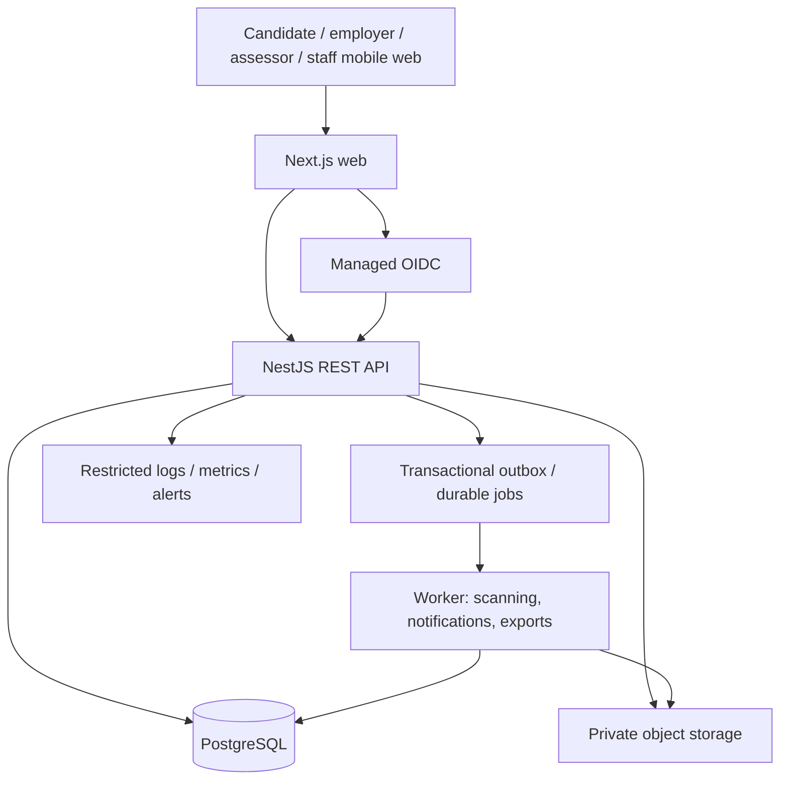

# System architecture proposal

## IMPLEMENTED — Phase 3B training foundation

Course-version aggregates pin module/lesson snapshots; enrollments and progress reference exact versions. The new training controller/service/repository reuses existing JWT guards, database-managed permissions, PostgreSQL transactions and audit_events. Competency and assessment links reference existing authoritative definitions; no question, evidence, scoring or readiness subsystem is added. See [TRAINING_MODEL.md](TRAINING_MODEL.md) and [ADR 0005](docs/adr/0005-governed-training-and-progress.md). Professional content approval remains disabled.

## Current implementation — Phase 3A

**IMPLEMENTED:** Migration 009 extends the canonical child-evidence ledger with source-specific external submission provenance, immutable submitted revisions and assessor proposal scaffolding. It introduces no new API endpoint or authentication change. Storage is an interface only; provider selection below remains a future recommendation. See [Phase 3 architecture](docs/PHASE3_ARCHITECTURE.md) and [ADR 0004](docs/adr/0004-phase-three-evidence-and-verification.md).

**PROPOSED / REQUIRES DOMAIN EXPERT VALIDATION:** Professional review, claims, readiness rules and Passport remain later milestones.

## Recommended stack and trade-offs

| Concern        | Recommendation                                                                      | Rationale and trade-off                                                                                                                                                                                                                |
| -------------- | ----------------------------------------------------------------------------------- | -------------------------------------------------------------------------------------------------------------------------------------------------------------------------------------------------------------------------------------- |
| Frontend       | Next.js, React, TypeScript                                                          | Accessible mobile web, server-rendered public content, shared language. Authenticated data must never enter shared/public caches. More framework complexity than a static React app, but supports discovery and future public content. |
| Backend        | NestJS TypeScript modular monolith                                                  | Explicit services, guards, validation and testability. Separate API adds deployment overhead versus Next.js-only; useful for independent domain boundaries, assessor workflows and future clients.                                     |
| Database       | Managed PostgreSQL with SQL migrations and parameterized node-postgres repositories | Strong relational constraints and transactions. Explicit SQL keeps ownership checks and constraints reviewable. Prisma can be added later without changing the domain model. No automatic production schema sync.                      |
| Authentication | Managed OIDC provider supporting MFA and verified email                             | Avoid operating password recovery and password storage ourselves. Provider pricing/data processing need review. Self-hosted Keycloak is an alternative when sovereignty outweighs operational cost. No custom password system.         |
| Files          | Private S3-compatible object storage                                                | Direct uploads with short-lived grants, quarantine and malware scanning; API-controlled downloads. Adds scanning lifecycle and asynchronous handling.                                                                                  |
| Hosting        | Managed Node containers + managed PostgreSQL + private object storage               | Portable, easier backups and operations. Choose region/provider after Nigerian legal and cost review; no assumption of local residency.                                                                                                |
| API            | Versioned REST, OpenAPI, cursor pagination                                          | Predictable mobile clients and integrations. GraphQL complexity is unnecessary for the pilot.                                                                                                                                          |
| Jobs           | PostgreSQL-backed durable jobs/outbox initially                                     | Notifications, scanning orchestration and exports without Redis infrastructure. Separate worker process when needed.                                                                                                                   |
| Search         | PostgreSQL structured filters and indexes                                           | Deterministic search for a small verified cohort. Dedicated search/vector services are unnecessary initially.                                                                                                                          |
| Tests          | Vitest domain tests; API/PostgreSQL integration tests; Playwright E2E               | Rules verified separately from real database and browser workflows.                                                                                                                                                                    |

Pin supported runtime/tool versions and dependency lockfiles during implementation. Provider selection must verify accessibility, deletion/export support, MFA, DPA, region, cost, backup and incident commitments.

## High-level design

Same-origin reverse proxy routes `/api/v1` to the API. Web uses secure, HttpOnly session cookies; API authorizes every request from server-validated identity. No access tokens in browser local storage. OIDC authorization-code flow with PKCE and state/nonce checking. CSRF protection applies to cookie-authenticated writes.

## Module boundaries

Identity & access; organizations; candidates & consent; pathways & competency definitions; content & learning; assessments & moderation; evidence & documents; credentials & passport; jobs & recruitment; scoring & matching; placements & feedback; notifications; audit & operations.

Modules own their writes; cross-module effects use application services and transactionally recorded events. The domain package computes scores without network or database side effects. No microservices, Kafka, or generalized AI agent layer in the pilot.

## Data flow and invariants

Learning completion records participation. Assessment outcomes record performance. Authorized verification records evidential decisions. Only the policy engine derives candidate competency and readiness from eligible, verified, current evidence. A human credential approval remains separate from the computed score.

An assessment attempt freezes its definition and rubric version. New content never retroactively changes old scores. Reassessment creates a new attempt. Correction, revocation and appeal create traceable events and a recomputed current projection.

Employer organization scope and candidate consent are checked at query and serialization boundaries. Employers cannot access assessor notes, raw practical evidence, private contact details or other organizations' recruiting records by guessing identifiers.

## Low-bandwidth operation

Text-first lessons; responsive images; optional video with quality choices and captions; resumable uploads; paginated results; idempotent progress checkpoints. Cache only public/non-sensitive static resources initially. Retry queued progress updates with attempt/revision identifiers; do not cache passports or examination answers on shared devices. Offline practical certification and offline examinations are deferred.

## Future AI boundary

An optional service can generate draft cases or feedback using reviewed/redacted inputs. Store model/version, input provenance and human approval. AI output cannot verify practical competence, approve credentials, or silently change matching policies. Procurement must prohibit unauthorized reuse of personal data. No AI infrastructure is needed for the MVP.

## Phase 1 implementation status

The modular monolith foundation is implemented. Managed-provider OIDC is wired and protocol-tested, but no Auth0 tenant has been provisioned. Persistence uses parameterized `pg` queries and transactional repositories, avoiding schema sync or duplicate ORM/schema sources in the initial migration set. Private object storage, workers/outbox, assessment governance execution and matching remain future milestones. Four draft pathway catalogs share one competency identity per core skill. Presentation → application/API → domain → persistence boundaries are retained.

## Implemented Phase 2 module

The assessment controller/service/repository implements the delivery, review and development API. Pure domain functions grade objective responses, compare exact evidence facets against version-bound requirements, and generate gap-linked activities. Shared contracts validate all untrusted inputs. Versioned content and frozen blueprints preserve prior attempts; a repeatable-read evaluation snapshot preserves each saved plan. No scoring/readiness aggregation or AI decisions are present. See [ADR 0003](docs/adr/0003-baseline-evidence-and-development.md) and [completion boundaries](docs/PHASE2_COMPLETION.md).

## Auth0 checkpoint

Browser authentication retains OIDC/PKCE and database RBAC. Migration 008 adds hashed, revocable browser-session handles; see [Auth0 checkpoint](docs/AUTH0_CHECKPOINT.md).

## Dairy-first case overlay (Phase 3C)

Case blueprints extend assessment versions rather than duplicating attempts, rubric observations or evidence. Ordered stages and rubric-dimension tags are relational, version-bound and frozen on delivery. One synthetic dairy template is isolated from software logic. An owner-only evidence manifest prepares provenance for a future passport without classifying readiness. See [DAIRY_CASE_MODEL.md](DAIRY_CASE_MODEL.md) and [ADR 0006](docs/adr/0006-dairy-first-case-blueprints.md).
