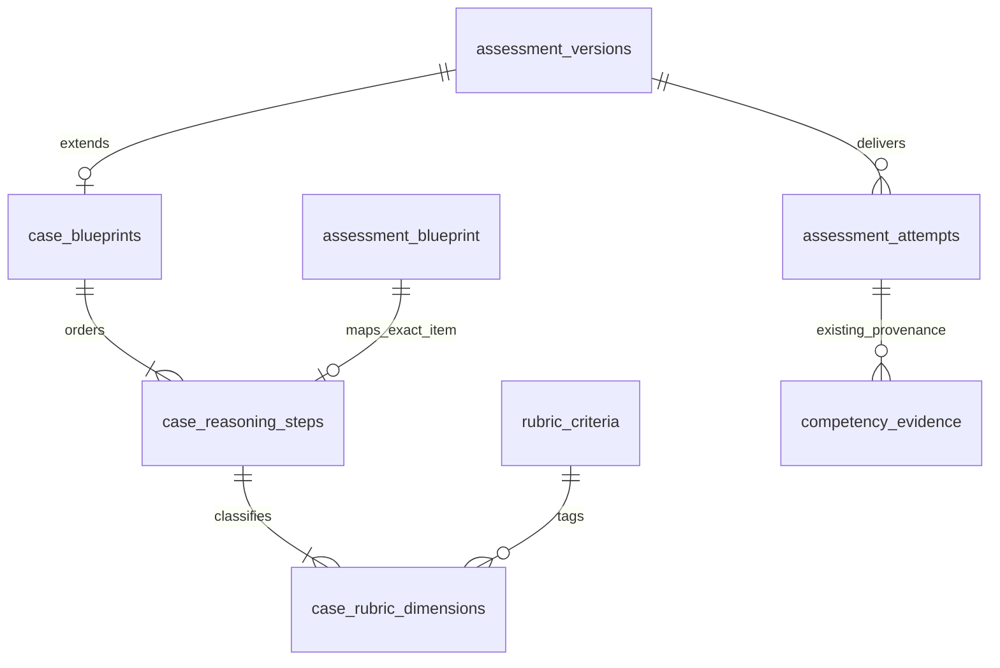

# Dairy-first governed case foundation — Phase 3C

**PROPOSED — REQUIRES DOMAIN EXPERT VALIDATION**

Commercial Dairy Practice is the first curriculum to operationalize. The other three existing pathways, all 47 groups and all 69 child competencies remain intact. No pathway activation flags, replacement taxonomy or parallel verification ledger are introduced.

Phase 3C provides one controlled **DEMO/DRAFT** Transition & Fresh Cow Investigation template and a reusable, pathway-agnostic case-authoring foundation. It does **not** claim to deliver production professional certification, a complete dairy curriculum or an approved readiness workflow.

## Existing dairy competency coverage

Each row below is a proposed application of existing definitions, not a new mandatory practical gate or approved professional standard. Version IDs and learning outcomes come from the existing hierarchy API. Broad child definitions still require expert refinement before professional use; no existing versions are edited here.

| Requested area                     | Existing reusable child code(s)                        | Review focus                                                                 |
| ---------------------------------- | ------------------------------------------------------ | ---------------------------------------------------------------------------- |
| 1. Herd-health investigation       | DAIRY_HERD_PLAN, DAIRY_INTEGRATED                      | Population patterns and causal uncertainty                                   |
| 2. Individual clinical examination | DAIRY_EXAM                                             | Authorized examination, safety and referral                                  |
| 3. Calf/colostrum management       | DAIRY_COLOSTRUM, DAIRY_CALF                            | Process evidence and clinical observations                                   |
| 4. Calf growth/weaning             | DAIRY_CALF                                             | Growth records and context-specific weaning evidence                         |
| 5. Heifer development              | DAIRY_HEIFER                                           | Breed/system context; no universal breeding targets                          |
| 6. Transition management           | DAIRY_TRANSITION_AUDIT                                 | Far-off, close-up, grouping and calving                                      |
| 7. Fresh-cow monitoring            | DAIRY_FRESH_REASON                                     | Clinical observations, intake, escalation                                    |
| 8. Metabolic disorders             | DAIRY_FRESH_REASON                                     | Hypocalcaemia, ketosis, displaced-abomasum risk; no diagnosis from narrative |
| 9. Mastitis/udder health           | DAIRY_UDDER_DATA, DAIRY_UDDER_AUDIT                    | SCC interpretation, clinical evidence, sampling boundaries                   |
| 10. Lameness                       | DAIRY_LOCOMOTION                                       | Reviewed method and supervised consistency                                   |
| 11. Reproduction/fertility         | DAIRY_FERTILITY, DAIRY_REPRO_OBSERVE                   | Heat detection, denominators and periods                                     |
| 12. Prevention/vaccination         | DAIRY_HERD_PLAN                                        | Context-specific, professionally authorized planning                         |
| 13. Biosecurity                    | DAIRY_HERD_PLAN, FIELD_SAFE                            | Herd planning versus observed behavior                                       |
| 14. Milk-production KPIs           | DAIRY_KPI                                              | Population, units, denominator and record quality                            |
| 15. Nutrition fundamentals         | NUTRITION_FOUNDATIONS                                  | Reused across dairy, poultry and premix                                      |
| 16. Feed intake/DMI                | DAIRY_FEED_AUDIT, NUTRITION_FOUNDATIONS                | Dry-matter basis, measurement and missing data                               |
| 17. Forage assessment              | DAIRY_FEED_AUDIT                                       | Sampling, variability and limitations                                        |
| 18. Concentrate/TMR interpretation | DAIRY_FEED_AUDIT                                       | Access, mixing/sorting and appropriate referral                              |
| 19. Water                          | DAIRY_FEED_AUDIT                                       | Availability, access, records and quality investigation                      |
| 20. Heat stress                    | DAIRY_FEED_AUDIT                                       | Environment, tropical context and measured evidence                          |
| 21. Body-condition scoring         | DAIRY_BCS                                              | Method anchors and supervised assessment                                     |
| 22. Dairy records/data             | DAIRY_KPI, DATA_PREPARE                                | Preserve original records and document corrections                           |
| 23. Excel/KPI interpretation       | DATA_PREPARE, DATA_VISUALIZE, DAIRY_KPI                | Spreadsheet evidence; written response alone does not prove Excel skill      |
| 24. Farm economics                 | DAIRY_ECONOMICS, COMMERCIAL_VALUE                      | Costs, alternatives and uncertainty                                          |
| 25. Farm auditing                  | AUDIT_METHOD, DAIRY_TRANSITION_AUDIT, DAIRY_FEED_AUDIT | Structured observations versus audit narrative                               |
| 26. Professional reporting         | REPORT_PRODUCE, DAIRY_INTEGRATED                       | Findings, interpretation, actions and confidentiality                        |
| 27. Farmer/staff communication     | COMM_BRIEF, NEEDS_INTERVIEW, TEAM_COORDINATE           | Audience, listening and understanding checks                                 |

The 27 areas are coverage categories, not 27 new database competencies. In particular, calf growth/weaning, feed intake, forage/TMR, water and heat stress are currently nested within broad existing definitions. Experts may propose new child versions or split them later; do not duplicate verified competency records to create course labels.

## Domain and persistence

Migration **011** adds three case tables and one composite rubric identity constraint. It does not rewrite migrations 001–010, content, permissions, users or prior evidence. The existing assessment version is the aggregate version and the rubric version boundary. A case stage points to the exact assessment blueprint/item/child/criteria versions. Dimension tags are not a second rubric or scoring engine.

The generic blueprint contract carries a scenario, content-template reference, unreviewed source references and ordered stages with explicit existing competency/criterion IDs. The checked-in professional template is isolated in `apps/api/src/cases/transition-fresh-cow.content.ts`; it contains no assessment algorithm. Nothing is seeded or released automatically. Its fictional records are software demonstration data, **not** clinical targets or authoritative benchmarks.

The content template suggests child codes. An author must fetch the existing pathway hierarchy and explicitly bind version IDs and criterion IDs. The author chooses which criteria support which dimensions; no weight, pass mark or numeric aggregate is defined. Stage/dimension associations remain proposed. The factory reuses existing AssessmentRepository authoring within one transaction, including canonical audit writes. A failed mapping or audit write rolls back the entire case.

## Reasoning and rubric

The ten stages are problem recognition; information gathering; differential assessment; evidence interpretation; investigation plan; intervention planning; herd-level prevention; monitoring; outcome evaluation; professional communication/reporting. Candidate attempts preserve this order. Sequential item order does not require unlocking one question at a time, and candidates can revisit saved answers before submission.

The thirteen rubric dimensions are clinical knowledge, clinical reasoning, herd-health reasoning, data interpretation, nutritional reasoning, risk identification, investigation quality, intervention planning, preventive thinking, economic awareness, communication, documentation and professional judgment. Qualitative observations remain attached to individual existing rubric criterion IDs. A dimension can tag multiple criteria; tags do not imply independent validated sub-scores. Experts must validate the task-specific anchors and dimension associations before production. No arbitrary case total is stored.

Only human-reviewed CASE/REPORT stages are allowed. There are no answer keys or automatic correctness awards for the case. Existing Phase 2 responses, submission, assignment, assessor observations, independent moderation and appeals remain the workflow. No new practical approval workflow or assessor-authority shortcut is introduced.

## Lifecycle and reproducibility

Authoring creates a demo assessment DRAFT with a named application author. `release-demo` is an explicit, separate existing action. DEMO is a technical delivery state; it is **not** EXPERT REVIEWED or APPROVED. Reviewer, review date and source references remain recorded independently; template review/effective dates are null. The case metadata explicitly reserves `professional_status` values DRAFT → EXPERT_REVIEWED → APPROVED → RETIRED and nullable `effective_at`, separately from technical delivery status. Only professional DRAFT with no effective date can be written in this increment; expert transitions/effective-date activation are deliberately blocked until a reviewed governance milestone. Production approval of a case is blocked at the database boundary.

Released case metadata, stage order, items, rubric and dimension mappings freeze. The release guard requires contiguous stages, complete item coverage, appropriate CASE-only items and a dimension mapping for every rubric criterion. Existing assessment retirement is terminal for delivery: no new attempts, while owner/assigned-assessor historical attempt views retain the consumed scenario, items and rubric. Revision creation allocates a new existing assessment version and exact new item versions; existing attempts and training references are not moved.

## Evidence and Skills Passport preparation

The owner-only evidence manifest exposes existing canonical evidence IDs, source kind, child version, facet, demo/status/observation, assessment/item/rubric references, assessor review identity/date, verification history and explicitly recorded validity. External submission receipts remain separate source references, not verified tasks. This is a private preparation view, **not a public passport, readiness classification or verification decision**. It is bounded to 500 recent entries and reports truncation. It intentionally excludes raw candidate responses, authorisation headers, tokens, documents and contact details.

SELF_DECLARED, DOCUMENT_VERIFIED, KNOWLEDGE_ASSESSED, CASE_ASSESSED, SIMULATION_VERIFIED, PRACTICALLY_VERIFIED and WORKPLACE_VERIFIED remain independent facets. The new manifest reads canonical assessed/submitted evidence; it is not a complete credentials/profile export. It does not synthesize self-declared skills or document verification from profile fields. Missing evidence remains UNVERIFIED, not failed competency. Demo evidence is labelled DEMO_ONLY even after assessor review/moderation. Rejected, revoked and expired production evidence is not displayed as an active verified claim. No professional expiry duration is invented; unspecified reassessment policy is explicitly NOT_CONFIGURED.

The nine requested readiness names are reserved in the domain vocabulary. No aggregation or transition rule is activated. The manifest always returns `readinessRulesActive: false` and `professionalReadiness: null`.

Practical submissions retain the existing Phase 3A source/context/target/version structure and owner-transition safeguards. Case reasoning never substitutes for supervised BCS, clinical examination, an actual farm audit or other observed performance. Practical verification remains blocked until approved assessor scope, conflict handling, assignment, supervised capture, policy and rubric governance are implemented and validated. Phase 3C does not expose new practical submission/upload or award endpoints.

## API and security

- `GET /admin/case-blueprint-templates/transition-fresh-cow`: existing `assessment:author` capability, proposed template only.
- `POST /admin/case-blueprints`: same existing platform authoring capability; creates an atomic mapped DRAFT case version.
- `GET /case-blueprints/:id`: existing `catalog:read`; candidates see released cases only, authors can inspect drafts. Retired versions remain accessible through authorized historical attempts.
- `GET /candidates/me/evidence-manifest`: existing `candidate:own`; user identity fixes ownership. This does not grant employer, admin cross-candidate or public access.
- Existing assessment attempt details include `caseBlueprint` (null for legacy assessments), protected by unchanged owner/assigned-assessor checks.

Existing JWT/scope validation, sessions, CSRF, authentication routes, database credentials and RBAC grants are unchanged. The existing server-rendered candidate assessment page now shows the consumed scenario, validation notice and stage titles while retaining the existing response/resume/submit forms. Text uses ordinary escaped React rendering; no HTML injection or new client bundle is introduced. No runtime role migration, upload acceptance, AI scoring, payment, employer access or public rankings are added. A training assessment reference is just a reference: completing a linked course/lesson creates no attempt, competence evidence, certificate, passport claim or readiness state.

## Expert and operational decisions still required

Appoint accountable dairy authors and independent reviewers. Validate competency splits, case realism, rubric anchors/dimension mapping, clinical examination and sampling scope, welfare/escalation requirements, current Nigerian VCN requirements and applicable professional law. Review authoritative current WOAH animal-health/welfare guidance, recognized veterinary clinical references and relevant dairy-nutrition guidance with qualified experts before incorporating any recommendations. These sources have **not** been used here to validate the synthetic content; this is a review agenda, not an endorsement or evidence citation.

Agree assessor eligibility/conflict/moderation/appeal procedures and a practical evidence collection/privacy policy. Establish professionally approved knowledge/case/practical/readiness and reassessment policies through a later governed change. Review Nigerian data-protection obligations and farm-owner consent for real records/images. No Drive materials were reviewed or claimed as support.

A subsequent explicitly authorized milestone may implement expert editorial governance and private supervised evidence capture around this case. Do not activate certification, JOB READY/FIELD READY, employer matching or placement from the demo.
