# Functional Dairy Competency Pilot — Phase 3D

**DRAFT — REQUIRES DOMAIN EXPERT VALIDATION**

This increment makes the existing Commercial Dairy Practice → Transition & Fresh Cow case usable through candidate and staff pages. It does not approve veterinary content or professional competency. All other pathway definitions, the 47 groups and the 69 children remain unchanged; no new poultry, pharmaceutical or premix pathway workflow is introduced.

## Workflow

```mermaid
flowchart LR
  A[Authenticated candidate and profile] --> B[Dairy workspace and career interest]
  B --> C[Released DEMO case and supplied evidence]
  C --> D[Structured reasoning saved per existing item]
  D --> E[Submit and freeze answers]
  E --> F[Owner assigns active assessor]
  F --> G[Private qualitative review drafts]
  G --> H[Finalize development feedback]
  H --> I[Candidate feedback and UNVERIFIED demo evidence]
  I --> J[Separate future supervised verification]
```

The web entry is `/dairy`, linked from `/dashboard`. Owner/assessor entry is `/dairy/review`. Owners explicitly prepare the controlled draft, inspect `/dairy/review/blueprint?id=...`, and release it only for DEMO practice using the existing release action. No case is silently seeded, released or approved on startup, login, migration or candidate navigation.

Preparation adopts an existing matching Phase 3C DRAFT without replacing its item IDs. If the matching case was already delivered, it creates the next assessment version under the same stable assessment identity, preserving the earlier version and all consumed responses/references. If no matching case exists, the existing Phase 3C case factory instantiates its unchanged template. Modified scenarios or incomplete stage/rubric structures require owner review instead of silently combining inconsistent evidence. Preparation is transactionally serialized and idempotent. One controlled V1 adapter is supported; rotation after retirement requires a later governed change, never deletion of historical records.

## Facts, reasoning and versioning

The original ten Phase 3C reasoning stages and thirteen dimension names are reused. Introduction/context and supplied evidence are read-only and identified as fictional case reports, not established diagnoses or targets. Candidate JSON stores only the applicable categories beneath `reasoning`:

- observations;
- interpretation / hypotheses;
- assumptions and limitations;
- requested information/evidence;
- priorities and rationale;
- conditional actions;
- monitoring/reassessment;
- safety/escalation.

The stage configuration defines which categories apply. Unknown fields, including fabricated `facts`, model answers, scores or verification flags, are rejected. The scenario, supplied evidence, category configuration and private guidance are bound to the exact assessment/item/rubric version and freeze on DEMO release. No competing case or assessment-item identity is introduced.

## Dairy competency coverage and limits

The earlier [27-area coverage matrix](DAIRY_CASE_MODEL.md) remains the authoritative proposed software mapping. The following organizational view reuses that hierarchy; it does not create ten duplicate domains, new professional standards or additional evidence awards.

| Dairy practice area          | Existing proposed child definitions                           | Interpretation in this pilot                                                                                         |
| ---------------------------- | ------------------------------------------------------------- | -------------------------------------------------------------------------------------------------------------------- |
| Farm orientation/biosecurity | FIELD_SAFE, AUDIT_METHOD, DAIRY_HERD_PLAN                     | Reasoning about entry, observation, records and safety; observed behavior requires supervision                       |
| Calf/youngstock              | DAIRY_COLOSTRUM, DAIRY_CALF, DAIRY_HEIFER                     | Retained for later dairy cases; not newly assessed in this case                                                      |
| Transition/fresh cows        | DAIRY_TRANSITION_AUDIT, DAIRY_FRESH_REASON                    | Direct case targets: far-off/close-up, calving, fresh-cow findings, risk and investigation                           |
| Reproduction                 | DAIRY_FERTILITY, DAIRY_REPRO_OBSERVE                          | Reproductive context retained; no numerical fertility standard or hands-on competence award                          |
| Udder health/milk quality    | DAIRY_UDDER_DATA, DAIRY_UDDER_AUDIT                           | Clinical/differential context, not a complete mastitis investigation credential                                      |
| Lameness/cow comfort         | DAIRY_LOCOMOTION, DAIRY_BCS                                   | Related observation/risk concepts; actual scoring or examination remains practically unverified                      |
| Nutrition/feeding            | NUTRITION_FOUNDATIONS, DAIRY_FEED_AUDIT                       | Intake/DMI, feed/water access, forage/TMR and heat-stress questions; no ration formulation or nutrient targets       |
| Herd health/prevention       | DAIRY_HERD_PLAN, DAIRY_EXAM                                   | Herd prevention is a case target; individual examination is a separate observed skill                                |
| Dairy data/KPIs              | DAIRY_KPI, DATA_PREPARE, DATA_VISUALIZE, DAIRY_ECONOMICS      | Interpretation, denominators, comparability, limitations and costs; written reasoning does not prove Excel operation |
| Investigation/communication  | DAIRY_INTEGRATED, NEEDS_INTERVIEW, REPORT_PRODUCE, COMM_BRIEF | Structured investigation and reporting; public targets distinguish evidence from qualification                       |

The dashboard lists the **actual child versions mapped by this case**, not every topic mentioned as a separate demonstrated competency. Clinical topics such as hypocalcaemia, ketosis, displaced-abomasum risk, retained placenta/metritis, udder problems, lameness, BCS, heat stress and pen/calving management are investigative context. No diagnosis, treatment protocol, dose, withdrawal period, disease target, nutritional recommendation or professional pass mark is established by the scenario. Task-specific rubric anchors and the extent of any future competency claims require expert validation.

## Candidate save/resume

Canonical answers remain in `candidate_responses`. A small generated revision table supplies optimistic concurrency for pilot answers without changing old response rows or creating a second answer ledger. Saves compare the expected revision; stale distinct edits receive 409, while an identical retry returns the existing revision. Submission uses the existing Phase 2 engine and freezes original answers. Technical response limits are transport/validation bounds, not professional thresholds.

Controlled client inputs retain entered text through React form resets on validation, network and stale-write failures; failed saves do not redirect away or put clinical text in URLs. A server confirmation identifies saved work. Navigation links use the same stage IDs; a before-unload warning helps protect unsaved work. Submission is disabled while local edits remain unsaved and requires acknowledgement; server-side completeness and immutable-response checks remain decisive. The candidate can reread locked answers and finalized feedback.

There is no offline database, localStorage clinical record, PWA, automatic background save or recovery after a browser crash. Keep the page open during a failed save. After a stale-write conflict, preserve the current text and inspect the latest saved version in another tab before reconciling; there is no automatic merge that could overwrite reasoning.

## Assessor workflow and immutable provenance

Only the assigned active platform assessor can save/finalize a review. Self-assignment/self-review are prohibited. Platform assignment staff can inspect submitted cases and choose active assessor account references; no contact directory or professional eligibility certification is implied by a technical role. Draft feedback is private to the assigned assessor. Owners can inspect governed blueprint/guidance and submitted material; this does not permit them to finalize without assessor authorization/assignment.

Draft revisions are append-only snapshots of qualitative judgments/comments, overall feedback and a development decision (`DEVELOPMENT_FEEDBACK` or `MORE_EVIDENCE_REQUIRED`). Null judgments and incomplete comments are allowed in drafts. Finalization requires every existing rubric criterion exactly once plus feedback, through the **existing** assessment review engine. No ad-hoc score, weight or pass flag is accepted. A finalization row binds the canonical review to its exact saved draft, actor and attempt; a deferred database constraint prevents bypass through the old direct-review endpoint or raw canonical review inserts. Audit failure rolls back finalization and canonical changes together.

The case/rubric version is derived from the immutable attempt → assessment version → item/rubric references; the evidence considered is the frozen submitted response set. Assessor identity, review dates, decision, criterion observations, draft revisions and request/audit references persist. Existing independent moderation and appeals remain available. Returned moderation preserves historical feedback and requires a fresh draft revision before another finalization. Identical retries can recover a lost acknowledgment without duplicating a finalized review.

## Candidate/staff separation

Candidate endpoints never serialize private guidance, working review drafts, protected rubric IDs/descriptions or dimension mappings for this pilot. The generic Phase 2 candidate attempt endpoint and public case-blueprint endpoint apply the same projection. General competency statements remain visible learning targets. After finalization the candidate sees only appropriate criterion feedback, dimension names, assessor/date/reference and development decision; private assessor guidance stays private. Older generic UI entry points direct pilot work to the new workflow instead of offering an incompatible response/review form.

Staff access is checked server-side using existing JWT/scope, platform RBAC, assignment and ownership rules. UI hiding is supplementary. Responses and staff pages remain no-store, source text is escaped, and bearer tokens/session material are never sent into client props or browser storage. No authentication/OIDC/session/CSRF implementation or role grants are changed.

## Progress and non-award boundaries

The dairy dashboard distinguishes pilot attempts, learning participation, knowledge evidence, case evidence and the separate pending practical process. Targets without evidence remain unverified, not incompetent. Recent evidence includes explicit facet, demo and verification status; self-declaration is not assessment. Progress is counts/statuses, not an employability/readiness percentage. The dashboard bounds history to 20 attempts and 200 recent evidence records and labels that scope.

Finalization creates qualitative human feedback and preserves CASE_ASSESSED evidence with UNVERIFIED status and DEMO provenance. It does not create practically verified skills, JOB READY/FIELD READY, certification, public passport claims, matching or placement. Training completion remains independent. Production approval, professional assessor-scope rules, practical verification, professional expiry and readiness decisions remain blocked/unapproved.

## Persistence

Forward-only migration 012 adds six small extensions over existing identities:

| Table                            | Purpose                                                          |
| -------------------------------- | ---------------------------------------------------------------- |
| dairy_pilot_versions             | Controlled version-bound adapter and fictional supplied evidence |
| dairy_pilot_stages               | Response categories keyed to existing case stages/items          |
| dairy_pilot_guidance             | Private guidance keyed to exact existing rubric criteria         |
| dairy_pilot_response_revisions   | Generated optimistic-concurrency clock; not an answer ledger     |
| dairy_pilot_review_drafts        | Immutable assessor-owned working review revisions                |
| dairy_pilot_review_finalizations | Canonical review ↔ exact draft binding                           |

No old column, migration 001–011, response payload, user/profile, role grant, evidence row or history is rewritten. Metadata reuses existing case freeze guards; canonical responses/reviews/evidence remain the established source. New guards apply only to registered pilot versions. Legacy workflows and populated pre-012 data remain valid. The migration is tested fresh and against populated 011 data, including finalized legacy feedback, browser sessions, evidence, training and audit records.

## Local review procedure and next milestone

After owner review/transfer, use the existing private local configuration and standard `npm run db:migrate`, `npm run dev:api` and `npm run dev:web`. No new secret/provider configuration is required. Do not put tokens, passwords or environment contents in chat.

1. Sign in with an existing platform author account; open `/dairy/review`.
2. Prepare the draft, inspect the exact scenario/mappings/private guidance, and explicitly release it for DEMO practice only.
3. As a candidate, save a profile, open `/dairy`, record dairy interest and open the case.
4. Enter distinct reasoning categories, save individual stages, reload/resume and confirm the recorded answers remain. Test a stale edit in another tab; keep the newer response instead of silently overwriting it.
5. Submit all stages; confirm original answers are locked and practical verification/readiness are not awarded.
6. As assignment staff, assign a known active assessor. As that assessor, inspect responses and private guidance, save an incomplete draft, reload/resume, complete all criterion judgments/comments and finalize development feedback.
7. As the candidate, inspect structured finalized feedback and UNVERIFIED DEMO evidence. Candidate views must not reveal private guidance or working drafts.
8. Recheck sign-out/protected dashboard behavior using the existing verified authentication lifecycle.

Recommended next milestone: owner/domain-expert review of the complete pilot, followed by separately authorized content/rubric governance and a carefully reviewed supervised-evidence pilot. This is not permission to activate certification, professional readiness, employer matching or deployment.
