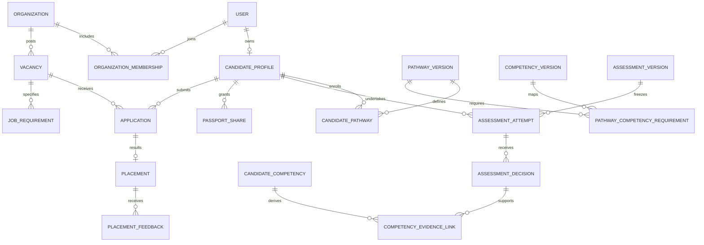
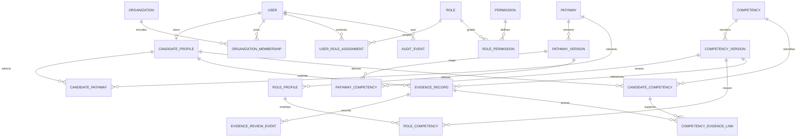
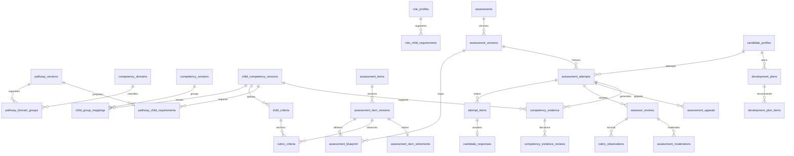

# Relational database architecture

## IMPLEMENTED — migration 010

Forward-only 010 adds stable course/module/lesson identities, course aggregate/module/lesson versions, scoped pathway/competency/assessment links, unique candidate/version enrollments, canonical lesson progress and immutable idempotency receipts. Composite FKs protect hierarchy, ownership and version consistency; triggers freeze released content and enforce state/revision/audit integrity. Only two explicitly scoped training capabilities and their ADMIN/SUPER_ADMIN permissions are added. Existing rows and migrations 001–009 are preserved. See [training ERD and invariants](TRAINING_MODEL.md).

## IMPLEMENTED — migration 009 foundation

Forward-only 009 adds `evidence_submissions`, `evidence_submission_versions`, `evidence_submission_competencies`, append-only `evidence_status_events`, and proposed-only `assessor_profiles`/`assessor_scope_grants`. Canonical `competency_evidence` gains `source_kind` (existing/default `ASSESSMENT`) and a nullable external version source, protected by XOR/composite FKs and per-source uniqueness. No migrations 001–008 change. No existing users, sessions, attempts, evidence, grants or audit history are rewritten.

Submitted revisions and referenced child definitions are immutable; transitions require an active owner, valid prior state and atomic audit. External receipts are strictly unverified, with exact source context/demo and no invented expiry. Assessor proposals grant no authority. See [relational details/ERD](EVIDENCE_MODEL.md) and [verification boundary](VERIFICATION_MODEL.md). Review/award tables and public sharing remain **PROPOSED**, not active.

This document distinguishes the target relational model from the implemented Phases 1–3B schema. UUID primary keys, `timestamptz` timestamps, explicit foreign keys and scoped authorization apply throughout. Monetary values use integer minor units with currency; no floating-point salaries.

## Core entities and relationships

| Tables                                                                                                     | Key fields and relationships                                                                                                                                                                                                  |
| ---------------------------------------------------------------------------------------------------------- | ----------------------------------------------------------------------------------------------------------------------------------------------------------------------------------------------------------------------------- |
| users, roles, permissions, role_permissions, user_role_assignments                                         | User has unique OIDC subject/provider, status. Role assignments are platform-scoped or organization-scoped with expiry and grantor. Roles are data, not fixed columns.                                                        |
| organizations, organization_memberships, employer_verifications                                            | Organization legal/display name, sector, status; unique member per user/organization; verification history and reviewer. Employer is an organization capability, not a duplicate person table.                                |
| candidate_profiles                                                                                         | Unique user FK, professional summary, location, relocation, availability, discovery preference; private contact separately protected.                                                                                         |
| locations, candidate_work_locations, languages, candidate_languages, candidate_sector_preferences          | Normalize selected regions/languages/sectors; avoid comma-separated fields. Locations support country/state hierarchy.                                                                                                        |
| candidate_qualifications, professional_registrations, candidate_experiences, candidate_references          | Candidate FK, dates, institution/authority, status and evidence; verification history separate from declarations. Reference contact data has its own consent/retention controls.                                              |
| pathways, pathway_versions, candidate_pathways                                                             | Stable pathway with reviewed published versions; candidate enrollment references exact version.                                                                                                                               |
| competencies, competency_versions, pathway_competency_requirements                                         | Unique competency code; versioned definitions; join maps level, required methods, gate, and weight into a pathway version.                                                                                                    |
| courses, course_versions, modules, lessons, lesson_assets, enrollments, learning_progress                  | Frozen published content versions; ordered modules/lessons; typed content and private/public asset policy. Completion records do not create competence.                                                                       |
| assessments, assessment_versions, questions, question_options, assessment_question_links                   | Method, instructions, eligibility, timing and published version; item weights; correct answers stored behind assessor-only access.                                                                                            |
| rubrics, rubric_versions, rubric_items, assessment_competency_links                                        | Frozen behavioral criteria, maxima/weights, approved critical errors, competency and level mapping.                                                                                                                           |
| assessment_attempts, attempt_responses, assessment_submissions                                             | Candidate and exact version, state, attempt number, start/submit times, response revision, immutable submitted snapshot.                                                                                                      |
| assessor_profiles, assessor_authorizations, assessor_assignments, conflict_declarations                    | User FK, professional qualifications; permitted competency/method scopes and expiry; attempt-specific assignment.                                                                                                             |
| practical_observations, rubric_scores, assessment_decisions, decision_events                               | Observation context/supervision; assessor scores by rubric item; decision, reasons, critical-error flags, verification/revocation events. Practical assessment extends an attempt rather than duplicating candidate identity. |
| evidence_items, documents, evidence_document_links, evidence_verifications                                 | Provenance, candidate, method, checksum, private object key, scan status, size/MIME, expiry and reviewer; files are never public URLs.                                                                                        |
| candidate_competencies, competency_evidence_links                                                          | Current derived projection unique per candidate/competency/scope; references accepted decisions and policy version. History remains in immutable underlying records.                                                          |
| development_plans, development_plan_items                                                                  | Diagnostic references, pathway version, target gaps, assigned learning/assessment, state and reasons.                                                                                                                         |
| score_policies, score_policy_versions, domain_weights, score_snapshots                                     | Reviewed parameters and immutable snapshots; normalized core dimensions, JSON snapshot for complete reproducibility.                                                                                                          |
| passport_shares, candidate_discovery_consents, consent_events, contact_grants                              | Recipient/audience, permitted sections, token digest, expiry, revocation, purpose and policy version. No raw share tokens stored.                                                                                             |
| credential_definitions, credential_requirements, credentials, credential_evidence_links, credential_events | Exact competency requirements, unique public certificate number, issue/expiry, human approver, status, verification token digest, evidence links.                                                                             |
| vacancies, vacancy_versions, job_requirements, vacancy_locations                                           | Organization owner, job status, salary bounds/currency/period, experience and relocation rules; versioned requirements with hard/soft indicator.                                                                              |
| applications, application_events, shortlists, shortlist_entries, recruitment_invitations                   | Candidate-vacancy uniqueness; explicit state transitions; employer-scoped notes; invitation expiry and contact permission.                                                                                                    |
| job_match_snapshots, match_components                                                                      | Candidate, vacancy/policy version, eligibility, bounds/coverage, input evidence references and component contributions.                                                                                                       |
| placements, placement_feedback, feedback_reviews, appeals, appeal_events                                   | Application link, start/end; scheduled 30/90/180-day review; candidate response, independent moderation; appeals target one assessment/credential/feedback decision.                                                          |
| notifications, audit_events, outbox_events, export_requests, deletion_requests                             | Delivery state; actor/action/resource/outcome and redacted metadata; durable transactional jobs; request verification and processing history.                                                                                 |

Mentorship sessions/goals and billing are deferred tables. Approved mentor feedback can be recorded as evidence commentary without granting verification privileges.

## ERD (principal relationships)

## Constraints and integrity

- Unique `(definition_id, version_number)`; published versions immutable. All attempts reference published versions. Duplicate pathway/competency requirement prohibited within the same scope.
- CHECK scores in [0,100], points between zero and maximum, nonnegative weights and salaries, salary minimum ≤ maximum, and end date ≥ start date. Validate weight sums transactionally at publication; row CHECK cannot enforce multirow sums.
- Composite organization keys/FKs protect recruitment ownership. Candidate evidence links must reference evidence for the same candidate, enforced with composite FKs where possible, otherwise guarded transactional database operations.
- Unique candidate/vacancy applications, rubric-item/assessor/attempt scores, candidate/lesson/enrollment progress and share-token digests.
- Frozen attempts, submitted evidence and decisions cannot be edited by ordinary application paths. Corrections append superseding records. Restrict runtime database permissions; use triggers for protected publication/event invariants where appropriate.
- Finalization, verification, projection recalculation and outbox write share a transaction. Optimistic revision checks prevent lost autosaves; idempotency keys protect submit/issue operations. Credential numbers allocated under unique constraint.
- Reject unsafe status transitions and assessor conflicts. Cross-row authorization is tested at service and database boundaries; UUIDs alone are not access controls.
- Avoid blanket cascading deletes. Assessment/audit/legal records require explicit retention decisions; deletion anonymizes or deletes based on lawful policy. Separate identity/contact data enables minimized retained evidence where legally justified.
- JSONB only for rich content blocks, immutable inputs and limited redacted event metadata; core relationships, roles, scores and consent remain relational.

## Indexes

Unique indexes above; candidate location/availability; pathway enrollment; current competency `(competency_id, verification_status, valid_until, candidate_id)`; vacancy organization/status/location; application vacancy/status; assessor assignment/status; attempt candidate/submitted_at; evidence candidate/status; share digest/expiry; audit resource/time and actor/time; pending outbox status/next_attempt. Partial indexes for active records and unprocessed jobs. Benchmark actual searches before adding GIN indexes or denormalized search projections.

## Audit and migrations

Append actor, effective role/organization, action, resource ID, timestamp, request ID, outcome and reason for privileged writes, evidence access, consent changes, verification, exports and recruiting access. Exclude passwords, tokens, CV bodies and raw clinical evidence from logs. Database owners can still alter records: restrict operator access and export security logs to access-controlled immutable storage when production governance requires it.

Version migrations in Git, review SQL, test from an empty database and from the previous release, and exercise constraints. Deploy backward-compatible expand/migrate/contract changes; take verified backups before destructive operations. Seed only synthetic people; production competency imports require reviewer attribution.

## Implemented Phase 1 ERD

Executable SQL is in `db/migrations/001_foundation.sql` and `002_integrity.sql`. Only the foundation tables exist; the broader table inventory above is a target design.

Candidate competency identity is `(candidate_id, competency_id)`, independent of pathway. Evidence references a version and has candidate-owner and competency-consistency checks. Organization role assignments require matching membership and scope. Approved definitions/pathway mappings and audit/review events are protected by triggers. No candidate projection is populated automatically by evidence submission. Phase 2 adds assigned assessment review and evidence-gap projections below; private document storage and professional eligibility policies remain pending.

Schema migrations use a checksum ledger and advisory lock, with one transaction per migration. Repeated seeds preserve existing version records and approved content. Tests only reset a dedicated local `_test` database. Runtime database access is not yet split from migration-owner privileges locally; separate least-privilege database roles are a production release prerequisite.

## Implemented Phase 2 schema (migrations 003–007)

Existing `competencies`/`competency_versions` remain the 47 organizing groups. `child_competencies`/`child_competency_versions` represent the 69 unique assessable children. `child_criteria` hold ordered outcomes, and reusable `child_group_mappings` preserve cross-pathway identities. `pathway_domain_groups` attaches a normalized domain to each pathway/group placement. `pathway_child_requirements` and `role_child_requirements` store proposed evidence routes; all seeded mandatory values remain null.

Composite foreign keys bind responses and evidence to the correct candidate/attempt/item, and blueprint group/child mappings to the selected pathway. Delivered content, rubrics, mappings and referenced children freeze; submitted responses freeze. Question retirement is an append-only event. Evidence provenance is immutable; verification requires approved non-demo content, an assigned independent assessor and latest-review moderation. Online evidence cannot be verified as simulation/practical/workplace performance. Audit/review/observation/plan records are append-only; development-item completion is a tracking field and never modifies competence.

Evidence context remains attached JSON because each assessment-derived record has one context; its parent attempt/version supplies provenance. Computed competency states/gaps remain projections. Saved plans contain a consistent requirement/evidence/gap snapshot and engine version rather than a mutable competing state table. Indices cover candidate attempts, evidence/child lookups and saved plans. See [ADR 0003](docs/adr/0003-baseline-evidence-and-development.md).

## Auth0 checkpoint

Migration 008 adds browser_sessions with unique SHA-256 handle hashes, user foreign keys, bounded expiry and audited revocation. No tokens or raw handles are stored in this table.
