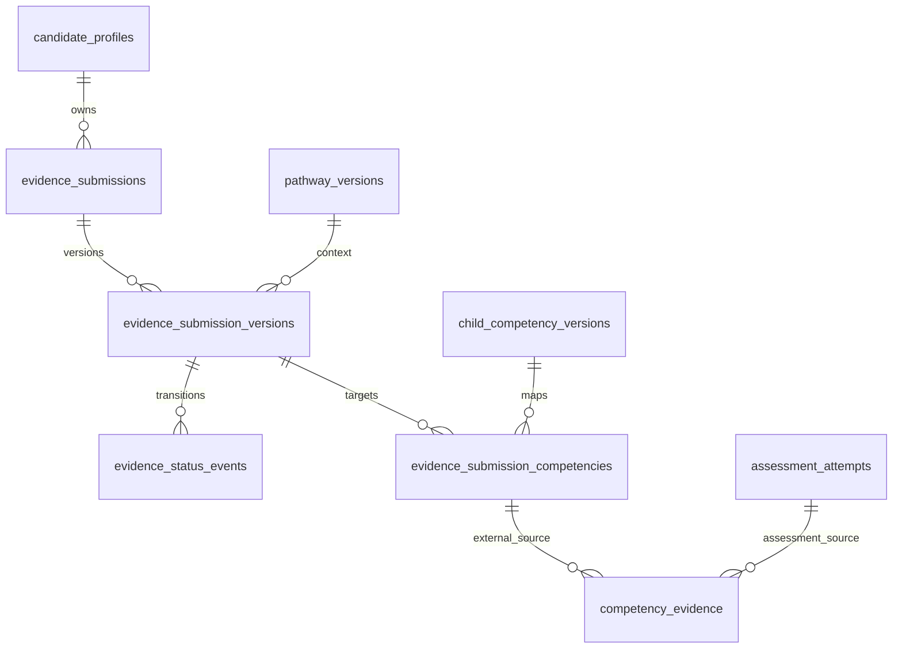

# Evidence model — Phase 3A

## IMPLEMENTED: one canonical ledger

`competency_evidence` remains the child-level evidence receipt/status ledger. The legacy group-level `evidence_records` API remains compatible; it does not become child verification automatically. Assessment attempts, responses, reviews and rubric observations remain Phase 2 sources. There is no second case engine, LMS truth store, award store or readiness engine.

Migration 009 adds the following relationships:

The source discriminator is `ASSESSMENT` (default, including existing rows) or `EXTERNAL_SUBMISSION`. Exactly one source is required: attempt + item, or submission version. A composite FK ties an external receipt to the same candidate, exact child version and requested facet. Existing assessment uniqueness/FKs remain; external receipts are unique per version/child/facet. Requested `PRACTICALLY_VERIFIED` is an evidence requirement label, not proof that practical verification happened.

Every external receipt must have `status=UNVERIFIED`, `observation=REQUIRES_REVIEW`, no `valid_until`, and match its submitted source's context/demo flag. It is immutable in 3A. The database also rejects external entries in `competency_evidence_reviews` until a later governed workflow is enabled. It cannot be verified, rejected or revoked through Phase 2 review routes, which require assessment provenance. Even non-demo external receipts cannot close a gap while unverified. No new official award mechanism is enabled.

## IMPLEMENTED: immutable submitted snapshots

A submission is a stable owner identity. Each version carries pathway, proposed evidence kind, summary, typed-context contract, demo designation and fixed validation notice. Targets are normalized child/facet mappings. Submitted content and targets cannot be edited or deleted. Referenced child definitions, criteria and mappings cannot be rewritten after submission; create a new child version instead.

Enabled transitions:

- Initial `DRAFT → SUBMITTED`, or `DRAFT → WITHDRAWN`.
- `SUBMITTED → WITHDRAWN`.
- After withdrawal, a new consecutive draft version references the latest version; `DRAFT → RESUBMITTED → WITHDRAWN`.

Revisions retain earlier snapshots. Versions cannot skip numbers, branch from an older version or coexist as independent drafts for one submission. Withdrawal does not erase source receipts or audit history. No verified claim exists to withdraw in 3A.

`UNDER_REVIEW`, `NEEDS_REVISION`, `VERIFIED` and `REJECTED` are reserved states. Review transitions and revision-after-review require a later migration/workflow; they are rejected now. These are deliberately scaffolding, not a partially enabled review service.

The security-invoker `transition_evidence_submission` function checks expected state and locks the row. Ownership and lifecycle triggers apply even to direct SQL changes. A future service must derive the actor from authenticated identity, enforce capability/ownership, and not accept actor/candidate identity from a client body. Shared application database credentials are not row-level authorization; no new HTTP routes expose these tables in 3A.

## IMPLEMENTED: audit and privacy boundaries

Version/identity changes, draft target changes, external receipts and scope proposals append to existing `audit_events` in the same transaction. `evidence_status_events` is append-only transition provenance generated by the version trigger, not a separate general audit log. Audit metadata contains IDs/status/version, not reports or farm data. Failed transitions and rolled-back writes retain neither partial state nor partial audits.

Owner IDs and composite FKs prevent cross-candidate source links. New records are private foundations with no public visibility or file URL. Contracts reject ownership overrides, approval/status overrides, demo-classification overrides and upload URLs. The future service must derive the source demo classification from trusted workflow configuration; it is not a candidate input. The storage port is an unbound interface only; there is no file acceptance, provider, credentials, signed URL or scan implementation.

## PROPOSED / REQUIRES DOMAIN EXPERT VALIDATION

Source categories, task/species/production-system context and future evidence applicability need expert review. Context is descriptive, never an authorization flag. Cross-pathway transfer/equivalence, assessor eligibility, review rubrics, validity/expiry and competence gates are not approved or active. DB context currently requires an object and task; the future API must use the stricter bounded contract and data-minimization policy.

The Poultry Farm Management layer-production investigation is the authorized future demo slice. Phase 3A uses a clearly labeled synthetic report fixture only; it publishes no course or clinical/nutritional advice. All four pathways reuse the same primitives. No professional numerical values have been seeded.
