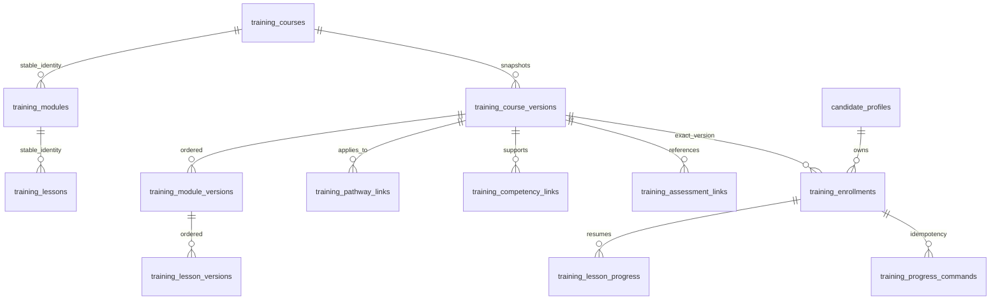

# Governed training and learning progress — Phase 3B

**IMPLEMENTED:** Text-only, demo-only training API foundations. **Training completion is not competence verification.**

## Hierarchy and versioning

Course, module and lesson have stable UUID identities and codes. A course revision is one governed snapshot: module/lesson snapshot UUIDs belong to that course revision and inherit its version number, lifecycle, author, source references and demo notice. There is no independent module/lesson publishing state that could drift from a consumed course.

Creating a later course version submits a complete snapshot. Matching module/lesson codes retain stable identity while receiving new snapshot UUIDs. New versions do not copy completion. Released snapshots and their hierarchy, ordering, mappings, text and objectives are immutable. Create a new course version for changes. Mapped competency definitions/criteria are protected from reinterpretation after release; use a new competency version.

## Content governance

The target lifecycle is DRAFT → EXPERT_REVIEWED → APPROVED → RETIRED. **Production expert-review/approval and non-demo content are disabled in this phase**, including database guards. An administrator can explicitly `release-demo`: content remains DRAFT with a demo-release timestamp and fixed validation notice, and becomes available for demonstration enrollment. That is not professional approval.

Release requires a complete course/module/lesson hierarchy, declared pathways, valid scoped mappings and released existing assessments. Retirement is terminal. New enrollment and new progress writes are blocked for retired content. Existing owners can inspect their exact historical snapshot, bookmarks, completion and timestamps. Previously completed learning is retained; retirement does not silently erase it. Safety withdrawal/redaction policy for real professional content needs later review.

Content uses **DEMO CONTENT — NOT YET APPROVED FOR PRODUCTION TRAINING** and **PROPOSED — REQUIRES DOMAIN EXPERT VALIDATION**. All examples in automated tests are synthetic navigation/recording text, with no clinical, biological, medicine, nutrition or pass-mark values. No production courses are automatically seeded.

## Competency and assessment mappings

Many-to-many mappings reference existing exact group OR child versions, scoped to a declared pathway version. Links may apply at course, module or lesson level. Composite FKs protect parent versions; source checks protect competency/pathway compatibility. These links mean “supports learning about,” never “candidate proved.” No competency definition is duplicated.

Assessment links reference existing Phase 2 assessment-version UUIDs in applicable pathways. Demo training may reference released DEMO or already APPROVED assessments. It cannot approve, copy or score them. Their retirement/status is returned with the reference. Attempts, answers, grading, moderation and verification remain in Phase 2; training creates none of them. Existing attempt APIs must be used separately.

There is no write path from training to the Phase 3A submission/evidence/review ledger. Practical activity submission interfaces/uploads, professional review and claim projection remain deferred. Phase 3A external receipts remain unverified.

## Enrollment, progress and resume

An enrollment is unique per candidate/exact course version, recording SELF or ASSIGNED, assigning actor and server timestamp. Self-enrollment uses the authenticated candidate; explicit administrative assignment requires `training:assign`. Repeated active enrollment is idempotent and retains its original provenance. Enrollment identity cannot be reassigned or deleted.

Lesson progress is canonical learning state. Completion is a self-reported participation marker, not proof of reading, mastery or performance. No row means NOT_STARTED. IN_PROGRESS/COMPLETED rows record exact course/module/lesson versions, revision, Unicode code-point resume offset, server timestamps and actor. Completion is absorbing: bookmarks can move, but completed learning cannot become in-progress or lose its original completion timestamp. Course/module summaries derive counts and completion time from their lesson rows; they are not independent editable completion stores. Zero lessons never implies completion.

A progress PUT supplies a client-generated `commandId`, expected lesson revision, state and resume position. Enrollment row locking serializes concurrent writes. A stale expected revision or reused command ID with different payload returns 409. Identical retries return the original result without another transition/audit. Replays can be older than current state: clients must compare revisions or GET current enrollment before replacing newer local state. Different lesson updates also serialize within one enrollment; adequate for this small foundation, with later load measurement before changing the lock boundary.

The idempotency table is a transport receipt, not a competence/evidence ledger. Its result must match actual persisted learning state and always reports `competenceVerified:false`. No progress operation creates an assessment pass, evidence verification, readiness percentage/classification, official award, certificate or Passport claim.

## Authorization and privacy

Existing Auth0/OIDC/JWT scope/session/logout behavior is unchanged. New `training:manage` and `training:assign` permissions are granted only to platform ADMIN/SUPER_ADMIN, both for populated upgrades and fresh migration+seed setup. Existing capabilities are not expanded or removed. Operational content authority does not confer professional assessor qualification.

Catalog access requires existing `catalog:read`; drafts are available only through management routes. Candidate progress/list/detail routes require `candidate:own` plus ownership in service/repository queries and database write guards. Foreign enrollment IDs return 404 and cannot be mutated. Shared application database credentials remain trusted infrastructure; they are not per-user RLS. Never accept actor, ownership, demo status or approval assertions from candidate JSON.

Existing `audit_events` receives course-version creation/governance, enrollment and progress-state transitions in the same transaction. Bodies/source narrative are excluded from audit metadata. Failure to append the audit rolls back the state and receipt. A bookmark-only update advances its revision/receipt but need not create another state-transition audit.

## Low-bandwidth boundaries and deferred work

Plain-text bodies are bounded; API details deliver one exact course snapshot and lists are capped. Existing private-response `Cache-Control: no-store` remains. This phase proves workflows through the API and PostgreSQL tests; no new large UI, native application, video, file upload, media provider, service worker or offline cache exists.

A later web/PWA client may queue owner/version/command IDs and revision-aware operations. It must handle 409 conflicts, re-authentication and retired content explicitly; private progress must not enter a public/shared cache. Cursor pagination, incremental lesson delivery, assignment notifications, command retention and cross-device conflict UX remain future work.

Production content approval, reviewer eligibility, content equivalence/credit transfer, real professional objectives, safety withdrawal and retention require separate expert/privacy review. Professional thresholds, readiness rules, certificates and public claims remain out of scope.

## Phase 3C case references

A released case assessment version can be referenced through the existing training assessment links. The link remains pinned to that version. Completing its preparation lesson does not start/submit the case, create evidence or change readiness. The case integration suite asserts this boundary explicitly.

## Phase 3D participation display

The dairy dashboard reads existing version-bound learning enrollments/completed-lesson counts separately from case progress and evidence. It does not complete courses, create assessments from lesson completion, close evidence gaps or award skills. Candidate reasoning and assessor feedback use the existing assessment workflow, not a second training evaluation system.
